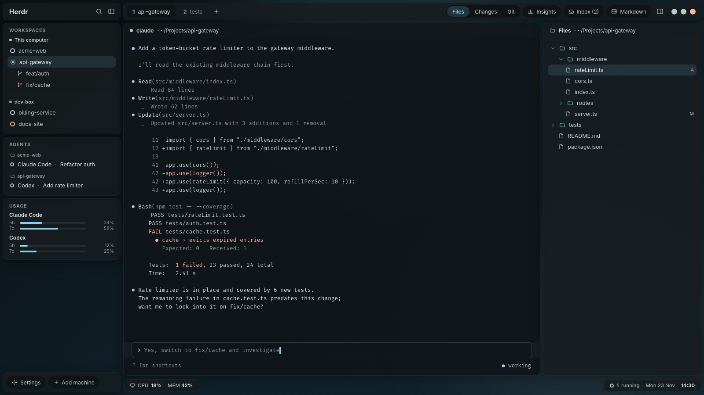

# Islands

A floating-islands layout for [Herdr App](https://herdr.dev) on Linux (and macOS), combining transparent glass islands, directory-grouped agents, worktree-nested workspaces, Font Awesome 6 icons, macOS-style solid window controls, and an extended Settings overlay.



## Acknowledgements & References

This layout and its mods are built upon and inspired by the following community layouts:

- **[relevo](https://github.com/johnny4young/herdr-relevo)** — Reference for the top-right toolbar integration (`Insights`, `Inbox`, `Plans` / `Markdown`, right-panel toggle), PR/worktree Inbox workflow, and multi-panel workspace layout.
- **[na29-islands](https://github.com/NA29/na29s-islands)** — Reference for the floating glass islands architecture, tmux-style prefix key overlay (`keybinds` + `tmux-prefix`), `settings-panel` customization system (transparency sliders, palette-aware solid/gradient/image wallpapers, theme picker), `goto` quick switcher, and `usage` / `status-bar` cards.

## Features

- **Floating Islands**: Transparent sidebar, tab strip, right utility panel, and status bar over your wallpaper, solid theme color, or gradient.
- **Workspaces (`mods/workspaces`)**:
  - Worktrees nested under their main repository card with Font Awesome `code-branch` icons.
  - Bold hollow colored rings for inactive spaces and `circle-dot` for the active space (no sequence numbers).
  - Drag-to-reorder machine sections with `1px` dividers and `8px` spacing.
- **Agents (`mods/agents-panel`)**:
  - Lists all running/recent agents grouped by directory basename with clear typographic hierarchy.
- **Top-Right Toolbar & Right Panel**:
  - `Files`, `Changes`, `Git` (`git-graph`), `Insights`, `Markdown` (`markdown-docs`), `Inbox`, right-panel toggle, and macOS-style solid `window-controls` (`minimize` / `maximize` / `close`) colored by the active Herdr theme.
- **Settings (`mods/settings-panel`)**:
  - Sidebar card customization: background color (theme palette), primary/secondary text color, font family, and font size (`10px–18px`).
  - Wallpaper manager with palette-following solid colors, gradients, and local image thumbnails.
- **Linux Support**:
  - `status-bar/stats.py` reads `/proc/stat`, `/proc/meminfo`, and `/sys/class/power_supply/` on Linux.
  - `keybinds` adapts global/prefix shortcuts for non-macOS modifiers (`ctrl-shift-*` / `ctrl-a`).
- **Themes**: Includes `themes/noctalia.json` (with full `colors` palette tokens) alongside 15 dark themes.

## Install

### Using a Herdr Agent

```text
Read ~/.config/herdr-app/AGENTS.md, then add this layout: onemotre/herdr-islands
```

### Manual Install

1. Copy `layouts/islands.json`, `mods/*`, and `themes/*` into `~/.config/herdr-app/`.
2. Switch to the `islands` layout in Herdr (`Ctrl+Shift+L` or `herdr-app do layout.switch --name islands`).
3. Open Settings (`Ctrl+,`) to configure your wallpaper folder, transparency, and sidebar card styles.

## License

Apache-2.0 — see [LICENSE](LICENSE) and [NOTICE](NOTICE).
Font Awesome Free SVG icons in `mods/fa-icons/` are licensed under CC BY 4.0.
